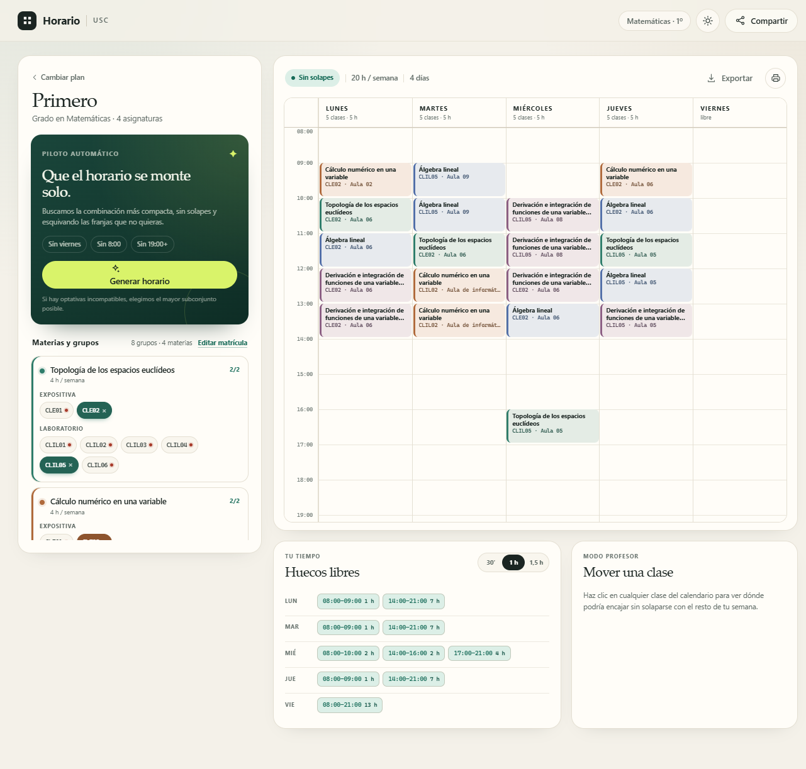

# Horario · constructor de horarios USC

Aplicación web para montar el horario semanal de los grados de **Matemáticas**,
**Física**, **Ingeniería Informática** e **Inteligencia Artificial**, y de los
dobles grados **Informática + Matemáticas** y **Matemáticas + Física** de la
Universidade de Santiago de Compostela. Eliges un grupo de expositiva,
laboratorio y seminario por materia y la aplicación valida solapes, muestra
cada semana del curso y permite compartir o exportar el resultado.

> **Estado:** prototipo funcional de hackathon. Los datos incluidos son una
> sincronización semana a semana del curso 2025/26 desde la web de la USC. No
> sustituyen al calendario oficial de la USC.



[Pantalla de inicio](docs/landing-light.png) · [Matrícula mixta](docs/workspace-mixed.png) · [Selector de matrícula](docs/plan-dialog.png) · [Extraescolares y fijaciones](docs/workspace-extras.png) · [Diálogo extraescolar](docs/event-dialog.png) · [Tema oscuro](docs/workspace-dark.png)

## Funcionalidad

- **Catálogo serializable y versionado** en `data/catalog.json`: grados, cursos,
  asignaturas, grupos, aulas, edificios y sesiones con ids estables.
- **Matrícula personalizada**: mezcla asignaturas de varios cursos y grados. Sirve
  para repetidores (1º + 2º) y para dobles grados (Matemáticas + Física), incluso
  con cursos distintos en cada título.
- **Tu horario se conserva**: «Volver al Inicio» no borra nada y el botón «Ir a mi
  horario» de la portada te devuelve a él. Solo «Nueva matrícula» lo borra todo
  (asignaturas, grupos y extraescolares) para empezar de cero.
- **Selector de grupos** de expositiva, laboratorio y seminario con aviso
  instantáneo de solapes. Se pueden marcar varios grupos del mismo tipo
  (p. ej. CLE01 y CLE02), pensado para profesores que imparten más de uno.
- **Calendario semanal** con bloques coloreados por materia, conflictos marcados
  y geometría a 30 minutos.
- **Bloques consecutivos unidos**: `9:00–10:00` + `10:00–11:00` se muestran como
  una sola clase `9:00–11:00` (también en el `.ics`), conservando las sesiones
  originales para moverlas o exportarlas.
- **Selector de semana** entre «Extraescolar» y «Exportar»: agrupa las semanas
  con el mismo horario, llama «Horario habitual» a la más repetida y nombra
  las demás («Primera semana», «Semana del 12 oct · 1 clase más»…). Por defecto
  marca la semana actual según la fecha del dispositivo. Solo se avisan los
  solapes de la semana que se está viendo.
- **Cuatrimestre automático**: al abrir la app se muestra el cuatrimestre de
  la fecha del dispositivo (el 2C empieza en su primera semana lectiva; enero
  cuenta como 1C). El botón «1º/2º Cuatrimestre» lo cambia solo durante esa visita.
- **Clases extraescolares** recurrentes: título, día, hora, lugar y color. Se
  pintan en el calendario y avisan de cruces.
- **Resolver solapes** desde la propia caja roja de solapes: cambia los menos
  grupos posibles entre los que ya has elegido. Después queda una caja verde con
  lo que ha cambiado, el botón «Revertir cambios» (también Ctrl+Z) y una cruz
  para cerrarla.
- **Grupos fijados**: un clic en una clase fija su grupo (⚑) y «Resolver
  solapes» no lo toca; otro clic lo desfija.
- **Compartir** con un enlace corto (se guarda una instantánea en el servidor,
  incluyendo extraescolares y fijaciones).
- **Exportar** a JSON, calendario `.ics` o PDF (la semana que se ve, en A4 apaisado, generado en el navegador y descargado directamente).
- **Sincronización real con la USC** usando el mismo acceso AJAX que la app de
  referencia, con fallback sintético en SQLite.
- **Colores USC** (azul `#000066` / `#004c93` de usc.gal), tema claro/oscuro,
  diseño responsive y persistencia local del horario.

## Stack

| Capa | Tecnología |
| --- | --- |
| Backend | Python 3.10+ · FastAPI · Pydantic v2 |
| Datos | JSON versionado con JSON Schema + validación referencial |
| Ingesta USC | `httpx` + BeautifulSoup + SQLite (`data/usc_sync.db`) |
| Frontend | HTML + CSS + JavaScript ES modules, sin build step |
| Tests | pytest + FastAPI TestClient |

No hay dependencias de frontend ni proceso de compilación: FastAPI sirve la SPA
directamente.

## Arranque rápido

```powershell
python -m venv .venv
.\.venv\Scripts\Activate.ps1
pip install -r requirements-dev.txt

# (opcional) refrescar el catálogo desde la USC
python scripts/sync_usc.py

uvicorn backend.main:app --reload
```

Abre <http://127.0.0.1:8000>. La documentación interactiva de la API está en
<http://127.0.0.1:8000/docs>.

En macOS/Linux:

```bash
python -m venv .venv
source .venv/bin/activate
pip install -r requirements-dev.txt
uvicorn backend.main:app --reload
```

## Tests

```powershell
.\.venv\Scripts\python.exe -m pytest
```

113 tests cubren integridad del catálogo, importación, detección de solapes
semana a semana, huecos, generación y reparación de solapes («Resolver
solapes»), matrículas que mezclan cursos/grados, bloques consecutivos,
extraescolares (también limitadas a algunas semanas), fijaciones, enlaces
compartidos, ICS, parser USC, fallback SQLite y los endpoints principales. La interfaz obtiene 100/100 en accesibilidad, buenas prácticas y SEO
con Lighthouse, tanto en tema claro como oscuro.

## Estructura

```text
backend/
  main.py          API FastAPI + servido de la SPA
  schemas.py       modelos de las peticiones
  ics.py           exportación a calendario
  models.py        modelo Pydantic y validación referencial
  scheduling/      solapes, validación, huecos, bloques unidos, generador y
                   reparación ("Resolver solapes"), un módulo por tarea
  store.py         índices del catálogo y persistencia de enlaces
  usc_source.py    acceso AJAX a la USC + fallback sintético + SQLite
  timeutil.py      horas HH:MM y días
  ids.py           slugs e ids estables
frontend/
  index.html
  css/styles.css
  js/              ES modules sin build: app.js (entrada), state, render,
                   schedule (solapes), plan, resolve, share… (ver AGENTS.md)
  js/timetable.js  render del calendario y layout de solapes
  js/api.js        cliente HTTP
data/
  catalog.json     catálogo canónico versionado
  usc_sync.db      BBDD SQLite de la última sincronización (live/synthetic)
  usc_sync.csv     CSV normalizado de la última sincronización
  shared_schedules/
scripts/
  import_legacy.py importador CSV/JSON -> catálogo
  sync_usc.py      USC AJAX o fallback sintético -> SQLite/CSV/catálogo
schema/
  catalog.schema.json
docs/
  data-model.md    decisiones de serialización y migración
tests/
```

## API

| Método | Ruta | Para qué |
| --- | --- | --- |
| `GET` | `/api/health` | estado y contadores |
| `GET` | `/api/catalog` | catálogo completo serializado |
| `GET` | `/api/catalog/export` | descargar el JSON canónico |
| `GET` | `/api/schema/catalog` | JSON Schema del catálogo |
| `GET` | `/api/degrees` | grados, cursos, asignaturas y metadatos |
| `GET` | `/api/years/{year_id}` | vista enriquecida de un curso (grupos + sesiones + aulas) |
| `GET` | `/api/plan` | matrícula enriquecida por `year_id` o `subject_ids` |
| `POST` | `/api/schedules/validate` | solapes, grupos que faltan, huecos y estadísticas |
| `POST` | `/api/schedules/generate` | generar una combinación de grupos |
| `POST` | `/api/free-slots` | complemento libre de un conjunto de grupos |
| `POST` | `/api/schedules/share` | guardar una instantánea y obtener id |
| `GET` | `/api/shared/{id}` | recuperar una instantánea compartida |
| `GET` | `/api/schedules/export.ics` | calendario `.ics` (cada clase en sus semanas) |
| `POST` | `/api/schedules/export.ics` | `.ics` con bloques unidos y extraescolares |
| `GET` | `/api/sync/status` | última sincronización USC (live/synthetic) |

Ejemplo de generación:

```bash
# Curso completo
curl -X POST http://127.0.0.1:8000/api/schedules/generate \
  -H 'Content-Type: application/json' \
  -d '{"year_id":"year-matematicas-1"}'

# Matrícula mixta: 1º de Matemáticas + 2º de Matemáticas + 1º de Mates-Física
curl -X POST http://127.0.0.1:8000/api/schedules/generate \
  -H 'Content-Type: application/json' \
  -d '{"subject_ids":[
    "sub-matematicas-1-elementos-de-probabilidad-y-estadistica",
    "sub-matematicas-2-diferenciacion-de-funciones-de-varias-variables-reales",
    "sub-matematicas-fisica-1-fisica-general-i"
  ]}'
```

## Acceso a los horarios de la USC

La app de referencia no descarga una página normal: hace un **POST AJAX a Drupal**
al widget del calendario, con `_drupal_ajax=1`, `js=true` y el token
`ajax_page_state[libraries]`, y parsea el fragmento HTML
`#course-detail-controller` (`.calendar-day`, `.ml-academic-subject`). Esa
mecánica está reproducida en `backend/usc_source.py`.

```powershell
# Intenta la USC para los 27 cursos de config.yaml; si un curso falla,
# rellena ese curso con datos sintéticos. Guarda la foto en SQLite.
python scripts/sync_usc.py

# Fuerza el fallback inventado (útil sin red o para demos)
python scripts/sync_usc.py --synthetic
```

La sincronización recorre todas las semanas de cada cuatrimestre
(`first_week`–`last_week` en `config.yaml`; las semanas sin clases se ignoran)
y cada sesión guarda en `weeks` las semanas en que se imparte. Con
`--single-week` descarga solo la semana tipo, como antes.

En la última ejecución respondieron los **27 cursos** (los dobles grados tienen
dos fuentes por curso), con 31 semanas lectivas, **4.676 sesiones**, 329
asignaturas y 1.912 grupos.

La sincronización escribe:

- `data/usc_sync.db`: SQLite con `sync_runs` y `sessions` (fuente `usc` o
  `synthetic`), consultable en `GET /api/sync/status`.
- `data/usc_sync.csv`: CSV legacy normalizado.
- `data/catalog.json`: catálogo que consume la API.

El endpoint de la USC puede cambiar su token o su HTML. En ese caso el script
registra el error y genera datos sintéticos para no dejar la aplicación sin
horarios. Después de sincronizar hay que **reiniciar FastAPI** para recargar el
catálogo.

Ejemplo con extraescolar y grupo fijado:

```json
{
  "year_id": "year-matematicas-1",
  "pinned_group_ids": ["grp-matematicas-1-elementos-de-probabilidad-y-estadistica-cle02"],
  "custom_events": [
    {"id":"evt-1","title":"Trabajo","day":"fri","start":"18:00","end":"20:00","location":"Oficina"}
  ]
}
```

## Modelo de datos

El detalle está en [`docs/data-model.md`](docs/data-model.md). En resumen:

```json
{
  "id": "ses-01230dadfe",
  "subject_id": "sub-matematicas-1-elementos-de-probabilidad-y-estadistica",
  "group_id": "grp-matematicas-1-elementos-de-probabilidad-y-estadistica-cle01",
  "type": "expositive",
  "day": "mon",
  "start": "13:00",
  "end": "14:00",
  "duration_minutes": 60,
  "room_id": "room-facultad-de-matematicas-aula-06",
  "building_id": "bld-facultad-de-matematicas",
  "instructors": [],
  "weeks": ["2025-W39", "2025-W40", "..."]
}
```

Frente al CSV original (`Primero;M11;...;Aula 02;11:00-12:00`), cada sesión es
autocontenida y no depende de una posición, de un separador ni de una etiqueta
de UI. Las referencias son ids; los nombres viven en su propia entidad. El
`slot` original se conserva en `legacy.slot` para trazabilidad.

## Decisiones y limitaciones

- **Edificio inferido.** El CSV no incluye edificio. El importador asigna
  *Facultad de Matemáticas* al Grado de Matemáticas y *Facultad de Física* al
  Doble Grado, y lo documenta en `source.notes`. Es un campo editable en el
  catálogo, no una verdad de la fuente.
- **Semanas.** El catálogo describe el curso 2025/26. Para elegir la semana
  actual y para el `.ics`, cada semana conserva su número ISO y se traslada al
  curso académico en vigor (la semana 43 de 2025 es la 43 de 2026). Las clases
  con semanas conocidas se exportan una vez por semana; las extraescolares,
  15 repeticiones desde el próximo
  lunes.
- **Optativas.** En 4º de Mates-Física hay materias que comparten franjas. El
  generador devuelve un subconjunto máximo sin solapes y lista las excluidas en
  lugar de producir un horario imposible.
- **Repeticiones y dobles grados.** El horario no se limita a un `year_id`: es
  una matrícula de asignaturas. Los dobles grados se construyen con dos fuentes
  oficiales por curso (Matemáticas + Física, Informática + Matemáticas) y cada
  sesión conserva el edificio de su facultad. La UI puede además mezclar
  asignaturas de cursos distintos.
- **Sin cuentas ni profesores.** El enlace compartido es una instantánea, no un
  documento colaborativo. El modelo ya reserva `instructors` por sesión y
  `kind` por aula para futuras extensiones.
- **Datos incluidos.** El catálogo es una sincronización real, semana a semana,
  del curso 2025/26 con los 6 grados. `scripts/sync_usc.py` permite refrescarlo desde la
  USC; si falla, genera un fallback sintético en SQLite. `scripts/import_legacy.py`
  queda solo para reproducir el snapshot CSV antiguo de Matemáticas/Mates-Física.
- **Aulas y edificios.** El edificio sale de la fuente de cada curso, salvo las
  aulas que `config.yaml` asigna a otro edificio (las `IA.*` a Emprendia; las
  aulas B, C y D y los laboratorios de instrumentación a Condesa).

## Próximos pasos

1. Sincronización programada (cron) y avisos cuando cambie una clase.
2. Plantillas oficiales de plan de estudios para cada grado y doble grado.
3. Persistencia en SQLite/Postgres y cuentas de estudiante.
4. Profesores y solicitudes de cambio de clase con aprobación.
5. Huecos comunes entre varios estudiantes de un mismo grupo.
6. Suscripción `.ics` actualizable y avisos de cambios.
