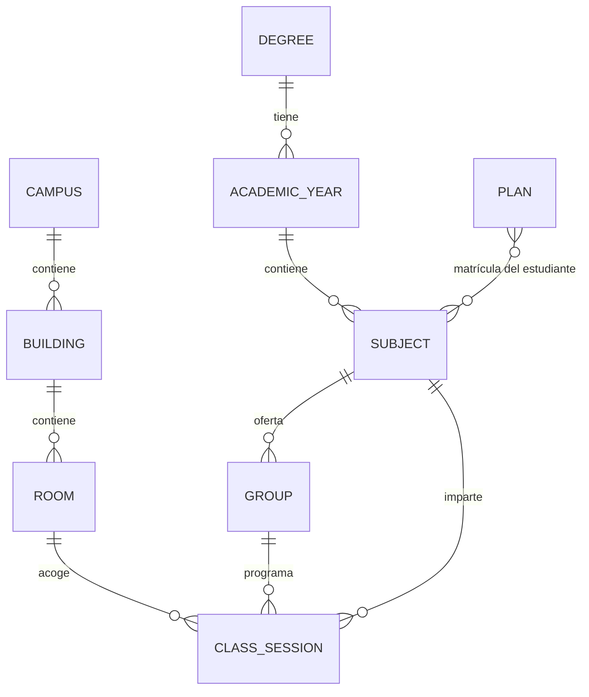

# Modelo de datos serializable

## Por qué cambiar el formato

El punto de partida era un CSV con una fila por clase:

```text
Curso;Slot;Asignatura;Grupo;Aula;Hora
Primero;M11;Topología de los espacios euclídeos;CLE02;Aula 06;11:00-12:00
```

Ese formato funciona para una hoja de cálculo, pero es frágil como API:

- `Slot` mezcla día y hora (`M11`) y `Hora` repite la información (`11:00-12:00`).
- El nombre de la asignatura y del aula se repiten en cada fila; renombrar algo
  implica reescribir cientos de filas.
- No hay edificio, tipo de sesión ni ids estables.
- El orden de las columnas y el separador forman parte del contrato.
- Es difícil validar referencias o evolucionar el esquema.

El catálogo actual (`data/catalog.json`, `schema_version: "2.0"`) separa cada
entidad, usa ids estables y referencias por id. Es un documento JSON que se puede
consumir desde el frontend, exportar, versionar en git, validar con JSON Schema
y migrar a base de datos sin cambiar el contrato de la API.

## Jerarquía



`PLAN` no es una entidad del catálogo: es la matrícula concreta del estudiante,
un conjunto de `subject_id` que la API compone en tiempo real. Todas las
relaciones persistidas son **por id**. No hay objetos anidados duplicados ni
referencias por índice de array. El catálogo es plano:

```text
catalog.json
├── schema_version, generated_at, source, term
├── campuses[]
├── buildings[]
├── rooms[]
├── degrees[]
├── years[]          # curso académico dentro de un grado
├── subjects[]
├── groups[]
└── class_sessions[]
```

## Entidades

### `term`

Contexto temporal del catálogo:

```json
{
  "id": "usc-2025-26-week-43",
  "label": "Curso 2025/26 · semana 43",
  "academic_year": "2025/26",
  "timezone": "Europe/Madrid",
  "week_start": "mon",
  "day_start": "08:00",
  "day_end": "21:00",
  "weeks": 15
}
```

`day_start`/`day_end` son la ventana de representación y de búsqueda de huecos.
`weeks` es el número de repeticiones de las actividades extraescolares en el
`.ics`. `calendar` lista las semanas lectivas descargadas, en orden:

```json
"calendar": [
  {"id": "2025-W37", "semester": 1, "monday": "2025-09-08"},
  {"id": "2026-W05", "semester": 2, "monday": "2026-01-26"}
]
```

### `degree` y `year`

Un `degree` es el título; un `year` es un curso concreto dentro de ese título.
Así se evita que «Primero» sea ambiguo entre Matemáticas y Mates-Física.

```json
{
  "id": "year-matematicas-fisica-1",
  "degree_id": "deg-matematicas-fisica",
  "number": 1,
  "name": "Primero",
  "subject_ids": ["sub-matematicas-fisica-1-fisica-general-i"]
}
```

En la UI, el usuario puede partir de un `year_id` (curso completo) o construir
una matrícula con asignaturas de varios años y grados.

### `subject`

```json
{
  "id": "sub-matematicas-1-elementos-de-probabilidad-y-estadistica",
  "year_id": "year-matematicas-1",
  "name": "Elementos de probabilidad y estadística",
  "slug": "elementos-de-probabilidad-y-estadistica",
  "group_ids": [
    "grp-matematicas-1-elementos-de-probabilidad-y-estadistica-cle01",
    "..."
  ]
}
```

`name` es el nombre para mostrar; `slug` es el nombre normalizado para ids y
URLs. El nombre no se usa como clave.

### `group`

Un grupo es la unidad que elige el estudiante (expositiva, laboratorio o
seminario). `type` es un valor de enum estable; `type_label` es solo texto de
presentación.

```json
{
  "id": "grp-matematicas-1-elementos-de-probabilidad-y-estadistica-cle02",
  "subject_id": "sub-matematicas-1-elementos-de-probabilidad-y-estadistica",
  "code": "CLE02",
  "type": "expositive",
  "type_label": "Expositiva",
  "session_ids": ["ses-01230dadfe", "..."]
}
```

Tipos:

| Prefijo legacy | `type` | `type_label` |
| --- | --- | --- |
| `CLE` | `expositive` | Expositiva |
| `CLIL` | `laboratory` | Laboratorio |
| `CLIS` | `seminar` | Seminario |
| otro | `other` | Otro |

La derivación se hace una sola vez en el importador, no en el frontend.

### `room` y `building`

```json
{
  "id": "room-facultad-de-matematicas-aula-06",
  "building_id": "bld-facultad-de-matematicas",
  "name": "Aula 06",
  "kind": "classroom"
}
```

`kind` permite distinguir `classroom`, `computer_lab` y `laboratory`. El aula no
duplica el edificio en su nombre: el edificio es una referencia.

### `class_session`

La pieza central. Es una reunión semanal recurrente, no una fecha concreta:

```json
{
  "id": "ses-01230dadfe",
  "subject_id": "sub-matematicas-1-elementos-de-probabilidad-y-estadistica",
  "group_id": "grp-matematicas-1-elementos-de-probabilidad-y-estadistica-cle01",
  "type": "expositive",
  "day": "mon",
  "start": "13:00",
  "end": "14:00",
  "duration_minutes": 60,
  "room_id": "room-facultad-de-matematicas-aula-06",
  "building_id": "bld-facultad-de-matematicas",
  "instructors": [],
  "weeks": ["2025-W39", "2025-W40", "2025-W41"],
  "note": null,
  "legacy": {
    "slot": "L13",
    "row": 9,
    "source": "horario.csv"
  }
}
```

Decisiones clave:

- **Día explícito** (`mon`…`sun`) en lugar de una letra dentro de un slot.
- **Hora local `HH:MM`** para inicio y fin. No se usan datetimes porque la clase
  se repite semanalmente; usar una fecha concreta obligaría a inventar el
  calendario lectivo.
- **`duration_minutes`** derivada y validada. Facilita sumar cargas semanales sin
  parsear strings en cada consumidor.
- **`room_id` y `building_id`** en la sesión. `building_id` es redundante con el
  aula, pero hace que una sesión serializada sea autocontenida para exportaciones
  y vistas simples; la validación exige que coincidan.
- **`instructors`** vacío hoy, preparado para añadir docentes sin romper el
  contrato.
- **`weeks`** son las semanas ISO (`2025-W43`) en que se imparte la sesión,
  todas de `term.calendar` y de su cuatrimestre. Una misma clase repetida varias
  semanas es una sola sesión con varias semanas; `null` significa «todas las
  semanas» (catálogos de semana tipo). Dos sesiones solo se solapan si además
  comparten alguna semana.
- **`legacy`** conserva la fila y el slot originales para auditar la migración.

## Matrícula: asignaturas de varios cursos y grados

El catálogo organiza las asignaturas por grado y curso para poder mostrar la
oferta, pero **la matrícula de un estudiante no es un curso**. Es un conjunto
arbitrario de `subject_id`:

```text
Matrícula de Ana
├── Matemáticas 1º: Topología, Cálculo, Álgebra, Derivación
├── Matemáticas 2º: Geometría Lineal
└── Doble Grado 1º: Física general I
```

Esto cubre dos casos reales:

- **Repetir curso.** Alguien de 2º que arrastra una asignatura de 1º no encaja
  en un único `year_id`. Su matrícula incluye asignaturas de ambos cursos.
- **Doble grado.** Un doble grado se compone de asignaturas de dos títulos (y a
  veces de cursos distintos). En el modelo, el grado es solo la procedencia de
  la asignatura; la matrícula puede mezclar `deg-matematicas` y
  `deg-matematicas-fisica` (o cualquier combinación futura).

Por eso la API de planificación ya no exige `year_id`:

```json
{
  "subject_ids": [
    "sub-matematicas-1-elementos-de-probabilidad-y-estadistica",
    "sub-matematicas-2-diferenciacion-de-funciones-de-varias-variables-reales",
    "sub-matematicas-fisica-1-fisica-general-i"
  ],
  "blocked": []
}
```

- `GET /api/plan?year_id=...` sigue siendo un atajo para una matrícula completa
  de un curso.
- `GET /api/plan?subject_ids=a,b,c` devuelve la vista enriquecida de cualquier
  combinación.
- `POST /api/schedules/validate` y `/generate` aceptan `subject_ids`.
- La validación informa de grupos que faltan **solo para las asignaturas de la
  matrícula**, no para todo el curso. Es la diferencia entre «me faltan grupos de
  mi matrícula» y «me faltan todas las optativas del grado».
- Los enlaces compartidos guardan `subject_ids`, por lo que una matrícula mixta
  sigue siendo reproducible.

En los datos de ejemplo, el «Doble Grado en Matemáticas y Física» aparece como
un `degree` separado porque así venía en la fuente, y solo incluye las
asignaturas de Física que había en el CSV. La UI permite completarlo con
asignaturas de `deg-matematicas`. Para una versión de producción, el siguiente
paso sería añadir **plantillas de plan de estudios** (`programs`/`curricula`)
que definan oficialmente qué asignaturas componen cada doble grado y en qué
curso; la matrícula seguiría siendo la selección concreta del estudiante.

## Bloques consecutivos

Las sesiones se guardan como reuniones individuales (una fila del CSV puede ser
`09:00-10:00` y otra `10:00-11:00`). La API calcula además una vista `blocks`
que une sesiones **del mismo subject, grupo, tipo, día, aula y edificio** cuando
son contiguas:

```json
{
  "id": "blk-ses-aaa",
  "session_ids": ["ses-aaa", "ses-bbb"],
  "start": "09:00",
  "end": "11:00",
  "duration_minutes": 120,
  "subject_name": "Cálculo numérico en una variable",
  "group_code": "CLE02"
}
```

La UI y el `.ics` usan `blocks`; `sessions` sigue conteniendo las reuniones
originales para mover, validar huecos y conservar trazabilidad. Los bloques con
varias sesiones se marcan como «bloque unido» y su movimiento ignora todos sus
`session_ids`, no solo el primero.

## Eventos extraescolares y horas fijadas

Dos conceptos independientes del catálogo universitario viajan con cada
validación, generación y enlace compartido:

- **`custom_events`**: actividades semanales inventadas por el usuario. Se
  modelan con `CustomEvent` (`id`, `title`, `day`, `start`, `end`, `location`,
  `color`). Ocupan tiempo, por lo que restan huecos, generan
  `event_conflicts` si pisan una clase y el solver las evita.
- **`pinned_group_ids`**: grupos cuyas horas son inamovibles. El generador
  preasigna esos grupos y no cambia su selección; el modo «mover» no ofrece
  huecos para una clase fijada. Se fija a nivel de grupo porque el solver decide
  grupos completos, no reuniones sueltas.

```json
{
  "custom_events": [
    {"id":"evt-1","title":"Entrenamiento","day":"mon","start":"18:00","end":"20:00","color":"#7c5cbf"}
  ],
  "pinned_group_ids": ["grp-matematicas-1-elementos-de-probabilidad-y-estadistica-cle02"]
}
```

## Convenciones de ids

| Entidad | Patrón | Ejemplo |
| --- | --- | --- |
| Grado | `deg-<slug>` | `deg-matematicas-fisica` |
| Curso | `year-<grado>-<n>` | `year-matematicas-1` |
| Asignatura | `sub-<año>-<slug>` | `sub-matematicas-1-algebra-lineal` |
| Grupo | `grp-<año>-<slug>-<código>` | `grp-matematicas-1-algebra-lineal-cle01` |
| Aula | `room-<edificio>-<slug>` | `room-facultad-de-matematicas-aula-02` |
| Edificio | `bld-<slug>` | `bld-facultad-de-matematicas` |
| Sesión | `ses-<sha1 corto>` | `ses-d3f1ad13c3` |

Los ids son estables entre importaciones: el de sesión se calcula con
`group_id | day | start | room_id`. Si una clase cambia de hora o de aula, cambia
su id, lo cual es deseable para detectar el cambio.

## Invariantes validadas con Pydantic

`backend/models.py` no solo documenta: valida al cargar el catálogo.

- Todos los ids son únicos por colección.
- `building.campus_id`, `room.building_id`, `year.degree_id`,
  `subject.year_id`, `group.subject_id`, `session.group_id`, `session.room_id` y
  `session.building_id` existen.
- El aula de una sesión pertenece al edificio declarado.
- `year.subject_ids`, `subject.group_ids` y `group.session_ids` coinciden
  exactamente con las entidades hijas (sin huérfanos ni referencias rotas).
- El tipo de una sesión coincide con el tipo de su grupo.
- `duration_minutes` es exactamente `end - start` y es positivo.
- `start`/`end` cumplen `HH:MM` y `end > start`.

El JSON Schema generado está en `schema/catalog.schema.json` y también se sirve
en `GET /api/schema/catalog`.

## Migración desde el legacy

`scripts/import_legacy.py` hace lo siguiente:

1. Lee `horario.csv` con `;` y `forms_data.json`.
2. Deduce grado y número de curso a partir de `Curso`
   (`Primero` → Matemáticas, `Primero Mates-Física` → Doble Grado).
3. Convierte `Slot` + `Hora`:
   `L09` + `09:00-10:00` → `day: "mon"`, `start: "09:00"`, `end: "10:00"`.
4. Deriva `group.type` del prefijo del código.
5. Normaliza aulas (`Aula 02`, `Aula de informática 2`, …) y las convierte en
   entidades `Room` dentro del edificio del grado.
6. Crea ids deterministas y referencias entre entidades.
7. Cruza `forms_data.json` con el CSV y avisa de grupos o asignaturas que no
   tienen sesiones.
8. Valida el documento completo con Pydantic antes de escribirlo.

El CSV se conserva intacto; el catálogo es el nuevo contrato.

### Edificio: legacy y sincronización real

En la importación legacy el CSV no contiene edificio y se aplica una heurística
por grado (documentada en `source.notes`). En la sincronización real, cada
`source` de `config.yaml` declara su edificio; los dobles grados pueden tener dos
fuentes y dos edificios para el mismo curso:

```yaml
- number: 1
  sources:
    - url: ".../5060/21207-1/25/43..."
      building: Facultad de Matemáticas
    - url: ".../5050/21207-1/25/43..."
      building: Facultad de Física
```

La columna opcional `Edificio` del CSV de sincronización conserva esa
procedencia por sesión. El catálogo resultante puede tener sesiones del mismo
curso en edificios distintos.

## Formato de un horario guardado

Un enlace compartido guarda una instantánea, no referencias mutables:

```json
{
  "schema_version": "2.0",
  "id": "ef95142e",
  "created_at": "2026-10-22T13:55:00+00:00",
  "title": "Matemáticas + Física · 3 materias",
  "year_id": null,
  "custom_events": [
    {"id":"evt-1","title":"Trabajo","day":"fri","start":"18:00","end":"20:00","color":"#7c5cbf"}
  ],
  "pinned_group_ids": [
    "grp-matematicas-1-elementos-de-probabilidad-y-estadistica-cle02"
  ],
  "subject_ids": [
    "sub-matematicas-1-elementos-de-probabilidad-y-estadistica",
    "sub-matematicas-2-diferenciacion-de-funciones-de-varias-variables-reales",
    "sub-matematicas-fisica-1-fisica-general-i"
  ],
  "group_ids": [
    "grp-matematicas-1-elementos-de-probabilidad-y-estadistica-cle02",
    "grp-matematicas-1-elementos-de-probabilidad-y-estadistica-clil05",
    "grp-matematicas-2-diferenciacion-de-funciones-de-varias-variables-reales-cle01",
    "grp-matematicas-fisica-1-fisica-general-i-cle01"
  ],
  "selections": [
    {
      "subject_id": "sub-matematicas-1-elementos-de-probabilidad-y-estadistica",
      "type": "expositive",
      "group_id": "grp-matematicas-1-elementos-de-probabilidad-y-estadistica-cle02"
    },
    {
      "subject_id": "sub-matematicas-1-elementos-de-probabilidad-y-estadistica",
      "type": "laboratory",
      "group_id": "grp-matematicas-1-elementos-de-probabilidad-y-estadistica-clil05"
    },
    {
      "subject_id": "sub-matematicas-2-diferenciacion-de-funciones-de-varias-variables-reales",
      "type": "expositive",
      "group_id": "grp-matematicas-2-diferenciacion-de-funciones-de-varias-variables-reales-cle01"
    },
    {
      "subject_id": "sub-matematicas-fisica-1-fisica-general-i",
      "type": "expositive",
      "group_id": "grp-matematicas-fisica-1-fisica-general-i-cle01"
    }
  ]
}
```

La lista `subject_ids` es la matrícula completa, aunque alguna asignatura
todavía no tenga grupo elegido. `year_id` se conserva solo cuando toda la
matrícula pertenece a un curso; en una matrícula mixta es `null`.

La respuesta de validación incluye las sesiones expandidas, los solapes, los
grupos que faltan, los conflictos con franjas bloqueadas, los huecos y las
estadísticas. El frontend puede renderizar sin volver a cruzar ids.

## Cómo añadir datos

### Nuevo curso o grado

1. Añade una entrada en `DEGREES` o amplía el origen de datos.
2. Añade las filas al CSV (o, mejor, escribe un importador directo).
3. Ejecuta `python scripts/import_legacy.py`.
4. Revisa los avisos del importador y valida con `pytest`.

### Nueva aula o edificio

Añade la entidad y actualiza las sesiones. La validación fallará si el aula no
pertenece al edificio. No hace falta tocar el frontend: recibe la vista
enriquecida por la API.

### Nuevos campos

Añade el campo al modelo Pydantic con un valor por defecto y actualiza el
importador. Incrementa `schema_version` si el cambio es incompatible. El frontend
solo consume los campos que necesita, así que los campos nuevos son aditivos.
