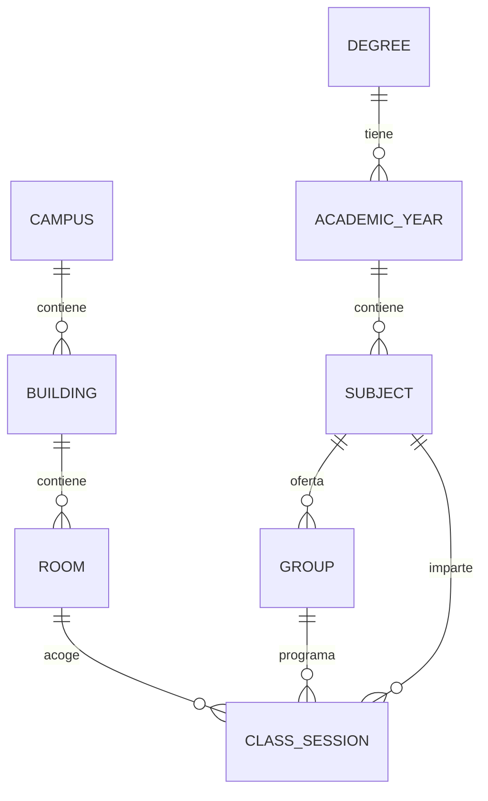

# Modelo de datos serializable

## Por qué cambiar el formato

El punto de partida era un CSV con una fila por clase:

```text
Curso;Slot;Asignatura;Grupo;Aula;Hora
Primero;M11;Topología de los espacios euclídeos;CLE02;Aula 06;11:00-12:00
```

Ese formato funciona para una hoja de cálculo, pero es frágil como API:

- `Slot` mezcla día y hora (`M11`) y `Hora` repite la información (`11:00-12:00`).
- El nombre de la asignatura y del aula se repiten en cada fila; renombrar algo
  implica reescribir cientos de filas.
- No hay edificio, tipo de sesión ni ids estables.
- El orden de las columnas y el separador forman parte del contrato.
- Es difícil validar referencias o evolucionar el esquema.

El catálogo actual (`data/catalog.json`, `schema_version: "2.0"`) separa cada
entidad, usa ids estables y referencias por id. Es un documento JSON que se puede
consumir desde el frontend, exportar, versionar en git, validar con JSON Schema
y migrar a base de datos sin cambiar el contrato de la API.

## Jerarquía



Todas las relaciones son **por id**. No hay objetos anidados duplicados ni
referencias por índice de array. El catálogo es plano:

```text
catalog.json
├── schema_version, generated_at, source, term
├── campuses[]
├── buildings[]
├── rooms[]
├── degrees[]
├── years[]          # curso académico dentro de un grado
├── subjects[]
├── groups[]
└── class_sessions[]
```

## Entidades

### `term`

Contexto temporal del catálogo:

```json
{
  "id": "usc-2026-27-semana-tipo",
  "label": "Curso 2026/27 · semana tipo",
  "academic_year": "2026/27",
  "timezone": "Europe/Madrid",
  "week_start": "mon",
  "day_start": "08:00",
  "day_end": "21:00",
  "weeks": 15
}
```

`day_start`/`day_end` son la ventana de representación y de búsqueda de huecos.
`weeks` se usa para exportar el `.ics`; no implica que el catálogo tenga datos de
15 semanas distintas.

### `degree` y `year`

Un `degree` es el título; un `year` es un curso concreto dentro de ese título.
Así se evita que «Primero» sea ambiguo entre Matemáticas y Mates-Física.

```json
{
  "id": "year-matematicas-fisica-1",
  "degree_id": "deg-matematicas-fisica",
  "number": 1,
  "name": "Primero",
  "subject_ids": ["sub-matematicas-fisica-1-fisica-general-ii"]
}
```

En la UI, el usuario elige un `year_id`, no una etiqueta textual.

### `subject`

```json
{
  "id": "sub-matematicas-1-topologia-de-los-espacios-euclideos",
  "year_id": "year-matematicas-1",
  "name": "Topología de los espacios euclídeos",
  "slug": "topologia-de-los-espacios-euclideos",
  "group_ids": [
    "grp-matematicas-1-topologia-de-los-espacios-euclideos-cle01",
    "..."
  ]
}
```

`name` es el nombre para mostrar; `slug` es el nombre normalizado para ids y
URLs. El nombre no se usa como clave.

### `group`

Un grupo es la unidad que elige el estudiante (expositiva, laboratorio o
seminario). `type` es un valor de enum estable; `type_label` es solo texto de
presentación.

```json
{
  "id": "grp-matematicas-1-topologia-de-los-espacios-euclideos-cle02",
  "subject_id": "sub-matematicas-1-topologia-de-los-espacios-euclideos",
  "code": "CLE02",
  "type": "expositive",
  "type_label": "Expositiva",
  "session_ids": ["ses-d3f1ad13c3", "..."]
}
```

Tipos:

| Prefijo legacy | `type` | `type_label` |
| --- | --- | --- |
| `CLE` | `expositive` | Expositiva |
| `CLIL` | `laboratory` | Laboratorio |
| `CLIS` | `seminar` | Seminario |
| otro | `other` | Otro |

La derivación se hace una sola vez en el importador, no en el frontend.

### `room` y `building`

```json
{
  "id": "room-facultad-de-matematicas-aula-06",
  "building_id": "bld-facultad-de-matematicas",
  "name": "Aula 06",
  "kind": "classroom"
}
```

`kind` permite distinguir `classroom`, `computer_lab` y `laboratory`. El aula no
duplica el edificio en su nombre: el edificio es una referencia.

### `class_session`

La pieza central. Es una reunión semanal recurrente, no una fecha concreta:

```json
{
  "id": "ses-d3f1ad13c3",
  "subject_id": "sub-matematicas-1-topologia-de-los-espacios-euclideos",
  "group_id": "grp-matematicas-1-topologia-de-los-espacios-euclideos-cle01",
  "type": "expositive",
  "day": "tue",
  "start": "11:00",
  "end": "12:00",
  "duration_minutes": 60,
  "room_id": "room-facultad-de-matematicas-aula-02",
  "building_id": "bld-facultad-de-matematicas",
  "instructors": [],
  "weeks": null,
  "note": null,
  "legacy": {
    "slot": "M11",
    "row": 29,
    "source": "horario.csv"
  }
}
```

Decisiones clave:

- **Día explícito** (`mon`…`sun`) en lugar de una letra dentro de un slot.
- **Hora local `HH:MM`** para inicio y fin. No se usan datetimes porque la clase
  se repite semanalmente; usar una fecha concreta obligaría a inventar el
  calendario lectivo.
- **`duration_minutes`** derivada y validada. Facilita sumar cargas semanales sin
  parsear strings en cada consumidor.
- **`room_id` y `building_id`** en la sesión. `building_id` es redundante con el
  aula, pero hace que una sesión serializada sea autocontenida para exportaciones
  y vistas simples; la validación exige que coincidan.
- **`instructors`** vacío hoy, preparado para añadir docentes sin romper el
  contrato.
- **`weeks`** permite modelar asignaturas que solo se imparten algunas semanas.
  En esta importación es `null` (semana tipo).
- **`legacy`** conserva la fila y el slot originales para auditar la migración.

## Convenciones de ids

| Entidad | Patrón | Ejemplo |
| --- | --- | --- |
| Grado | `deg-<slug>` | `deg-matematicas-fisica` |
| Curso | `year-<grado>-<n>` | `year-matematicas-1` |
| Asignatura | `sub-<año>-<slug>` | `sub-matematicas-1-algebra-lineal` |
| Grupo | `grp-<año>-<slug>-<código>` | `grp-matematicas-1-algebra-lineal-cle01` |
| Aula | `room-<edificio>-<slug>` | `room-facultad-de-matematicas-aula-02` |
| Edificio | `bld-<slug>` | `bld-facultad-de-matematicas` |
| Sesión | `ses-<sha1 corto>` | `ses-d3f1ad13c3` |

Los ids son estables entre importaciones: el de sesión se calcula con
`group_id | day | start | room_id`. Si una clase cambia de hora o de aula, cambia
su id, lo cual es deseable para detectar el cambio.

## Invariantes validadas con Pydantic

`backend/models.py` no solo documenta: valida al cargar el catálogo.

- Todos los ids son únicos por colección.
- `building.campus_id`, `room.building_id`, `year.degree_id`,
  `subject.year_id`, `group.subject_id`, `session.group_id`, `session.room_id` y
  `session.building_id` existen.
- El aula de una sesión pertenece al edificio declarado.
- `year.subject_ids`, `subject.group_ids` y `group.session_ids` coinciden
  exactamente con las entidades hijas (sin huérfanos ni referencias rotas).
- El tipo de una sesión coincide con el tipo de su grupo.
- `duration_minutes` es exactamente `end - start` y es positivo.
- `start`/`end` cumplen `HH:MM` y `end > start`.

El JSON Schema generado está en `schema/catalog.schema.json` y también se sirve
en `GET /api/schema/catalog`.

## Migración desde el legacy

`scripts/import_legacy.py` hace lo siguiente:

1. Lee `horario.csv` con `;` y `forms_data.json`.
2. Deduce grado y número de curso a partir de `Curso`
   (`Primero` → Matemáticas, `Primero Mates-Física` → Doble Grado).
3. Convierte `Slot` + `Hora`:
   `L09` + `09:00-10:00` → `day: "mon"`, `start: "09:00"`, `end: "10:00"`.
4. Deriva `group.type` del prefijo del código.
5. Normaliza aulas (`Aula 02`, `Aula de informática 2`, …) y las convierte en
   entidades `Room` dentro del edificio del grado.
6. Crea ids deterministas y referencias entre entidades.
7. Cruza `forms_data.json` con el CSV y avisa de grupos o asignaturas que no
   tienen sesiones.
8. Valida el documento completo con Pydantic antes de escribirlo.

El CSV se conserva intacto; el catálogo es el nuevo contrato.

### Edificio inferido

El CSV no contiene edificio. El importador aplica esta heurística, documentada
en `source.notes`:

- Grado en Matemáticas → `Facultad de Matemáticas`.
- Doble Grado en Matemáticas y Física → `Facultad de Física`.

Es un dato de ejemplo editable. En producción debería venir de la fuente
oficial o de una tabla de aulas.

## Formato de un horario guardado

Un enlace compartido guarda una instantánea, no referencias mutables:

```json
{
  "schema_version": "2.0",
  "id": "ef95142e",
  "created_at": "2026-10-22T13:55:00+00:00",
  "year_id": "year-matematicas-1",
  "group_ids": [
    "grp-matematicas-1-topologia-de-los-espacios-euclideos-cle02",
    "grp-matematicas-1-topologia-de-los-espacios-euclideos-clil05"
  ],
  "selections": [
    {
      "subject_id": "sub-matematicas-1-topologia-de-los-espacios-euclideos",
      "type": "expositive",
      "group_id": "grp-matematicas-1-topologia-de-los-espacios-euclideos-cle02"
    },
    {
      "subject_id": "sub-matematicas-1-topologia-de-los-espacios-euclideos",
      "type": "laboratory",
      "group_id": "grp-matematicas-1-topologia-de-los-espacios-euclideos-clil05"
    }
  ]
}
```

La respuesta de validación incluye las sesiones expandidas, los solapes, los
grupos que faltan, los conflictos con franjas bloqueadas, los huecos y las
estadísticas. El frontend puede renderizar sin volver a cruzar ids.

## Cómo añadir datos

### Nuevo curso o grado

1. Añade una entrada en `DEGREES` o amplía el origen de datos.
2. Añade las filas al CSV (o, mejor, escribe un importador directo).
3. Ejecuta `python scripts/import_legacy.py`.
4. Revisa los avisos del importador y valida con `pytest`.

### Nueva aula o edificio

Añade la entidad y actualiza las sesiones. La validación fallará si el aula no
pertenece al edificio. No hace falta tocar el frontend: recibe la vista
enriquecida por la API.

### Nuevos campos

Añade el campo al modelo Pydantic con un valor por defecto y actualiza el
importador. Incrementa `schema_version` si el cambio es incompatible. El frontend
solo consume los campos que necesita, así que los campos nuevos son aditivos.
